# 现场调试链表式菜单手册（LCD200 版）

> 版本：v1.0（2026-11-14）
> 适用：STM32F407VE 双轮差速车，`menu` 分支
> 代码：`CODE/Car_menu.c`、`CODE/Car_menu.h`、`CODE/key.c`、`CODE/key.h`、`CODE/Car_params.c/h`
> 显示：LCD200，320×240 横屏，`ASCII_Font24`（12×24 像素），10 行
>
> **本版已把原有“数独/香橙派/赛题元素PID/电池”竞赛资料目录替换为现场调试菜单。**
> 旧版手册中的竞赛节点表、PID 页索引和得分/罚时字段不再对应代码。

---

## 1. 现场调试目标

菜单只做四类事：

| 一级目录 | 用途 |
|---|---|
| `STATUS` | 只读查看状态、故障、模式、双轮速度/参考/输出、视觉、电池 |
| `TUNE` | 停车时修改左右轮 PID、限幅、CPR、电池阈值 |
| `ACTIONS` | 停车/清故障、保存 Flash、读取 Flash、恢复默认值 |
| `INFO` | 固件版本、节点数、建链错误数、Flash 是否有有效参数 |

菜单**不提供**电机点动、发车、自动/手动切换等运动动作，避免现场误触。

---

## 2. 显示布局与滚动规则

```text
LCD200 320×240，10 行 × 24 px，每行最多 26 个 ASCII 字符
┌──────────────────────────────┐  y=0
│ MAIN>TUNE>PID LEFT           │  第 0 行：路径，固定，不参与滚动
│ STOP F0 MANUAL 12.4V         │  第 1 行：状态/故障/模式/电压/提示，固定
├──────────────────────────────┤  y=48
│  PID RIGHT                   │  第 2 行（列表第 1 行）
│ >L KP: 2.00                  │
│  L KI: 0.12                  │
│  L KD: 0.00                  │
│  ...                         │
│  item n-2                    │  第 7 行 = 倒数第 3 行 = 滚动锚点
│  item n-1                    │  第 8 行
│  item n                      │  第 9 行
└──────────────────────────────┘
```

规则：

1. 行 0、行 1 固定，不随列表滚动；
2. 列表区为行 2~9，共 8 项；
3. 选中项向下移动时，一旦到达**倒数第 3 行（屏幕第 7 行，列表第 6 行）**，列表开始向上滚动，选中项保持在该行；
4. 选中项回到列表顶部时，滚动偏移回到 0；
5. 同级节点是**环形双向链表**，UP 到第一项会绕到最后一项，DOWN 反之；
6. 选中行白底黑字，其余黑底白字，选中行前有 `>`。

### 行 1 提示

- 正常：`STOP F0 MANUAL 12.4V`
- 编辑提交：`APPLIED`
- 非停车编辑：`STOP FIRST`
- 参数越界/应用失败：`STOP/PARAM FAIL`
- Flash：`SAVED` / `SAVE FAIL` / `LOADED` / `LOAD FAIL`
- 提示持续约 1.5 s，然后恢复状态行。

---

## 3. 按键

按键驱动 `CODE/key.c`，四键低电平有效、内部上拉：

| 按键 | 引脚 | 浏览 | 编辑 |
|---|---|---|---|
| UP | PE10 | 上一项 / 到环形链尾 | 增加步长 |
| DOWN | PE8 | 下一项 / 到环形链头 | 减少步长 |
| OK | PE7 | 进入页面 / 进入编辑 / 长按执行动作 / 长按回 MAIN | 提交并应用；长按也可提交 |
| BACK | PE9 | 返回父页面 / 长按回 MAIN | 取消编辑 |

- 单击立即响应：`KEY_ENABLE_DOUBLE_CLICK = 0`，避免 300 ms 双击窗口拖慢现场调参；
- 动作节点（`STOP/CLEAR`、`SAVE FLASH`、`LOAD FLASH`、`DEFAULTS`）必须**长按 OK** 才执行；
- 长按 OK 在普通页面/叶子节点上回到 MAIN；
- 长按 BACK 随时回到 MAIN。

---

## 4. 菜单树状图

### 4.1 ASCII

```text
MAIN
├── STATUS
│   ├── STATE
│   ├── FAULT
│   ├── MODE
│   ├── L SPEED
│   ├── R SPEED
│   ├── L REF
│   ├── R REF
│   ├── L OUT
│   ├── R OUT
│   ├── VISION
│   └── BATTERY
├── TUNE
│   ├── PID LEFT
│   │   ├── L KP
│   │   ├── L KI
│   │   └── L KD
│   ├── PID RIGHT
│   │   ├── R KP
│   │   ├── R KI
│   │   └── R KD
│   ├── LIMITS
│   │   ├── RPM LIMIT
│   │   ├── PWM LIMIT
│   │   ├── ACCEL
│   │   └── JERK
│   ├── ENCODER
│   │   └── CPR X10
│   └── BAT THRESH
│       ├── WARN MV
│       └── CUT MV
├── ACTIONS
│   ├── STOP/CLEAR
│   ├── SAVE FLASH
│   ├── LOAD FLASH
│   └── DEFAULTS
└── INFO
    ├── FW VERSION
    ├── NODE COUNT
    ├── LINK ERR
    └── FLASH
```

### 4.2 Mermaid

```mermaid
graph TD
  MAIN --> STATUS
  MAIN --> TUNE
  MAIN --> ACTIONS
  MAIN --> INFO

  STATUS --> ST_STATE[STATE]
  STATUS --> ST_FAULT[FAULT]
  STATUS --> ST_MODE[MODE]
  STATUS --> ST_SPD_L[L SPEED]
  STATUS --> ST_SPD_R[R SPEED]
  STATUS --> ST_REF_L[L REF]
  STATUS --> ST_REF_R[R REF]
  STATUS --> ST_OUT_L[L OUT]
  STATUS --> ST_OUT_R[R OUT]
  STATUS --> ST_VISION[VISION]
  STATUS --> ST_BATT[BATTERY]

  TUNE --> TU_PID_L[PID LEFT]
  TUNE --> TU_PID_R[PID RIGHT]
  TUNE --> TU_LIMITS[LIMITS]
  TUNE --> TU_ENC[ENCODER]
  TUNE --> TU_BATT[BAT THRESH]

  TU_PID_L --> PL_KP[L KP]
  TU_PID_L --> PL_KI[L KI]
  TU_PID_L --> PL_KD[L KD]
  TU_PID_R --> PR_KP[R KP]
  TU_PID_R --> PR_KI[R KI]
  TU_PID_R --> PR_KD[R KD]

  TU_LIMITS --> LM_RPM[RPM LIMIT]
  TU_LIMITS --> LM_PWM[PWM LIMIT]
  TU_LIMITS --> LM_ACC[ACCEL]
  TU_LIMITS --> LM_JERK[JERK]

  TU_ENC --> EN_CPR[CPR X10]
  TU_BATT --> BT_WARN[WARN MV]
  TU_BATT --> BT_CUT[CUT MV]

  ACTIONS --> AC_STOP[STOP/CLEAR]
  ACTIONS --> AC_SAVE[SAVE FLASH]
  ACTIONS --> AC_LOAD[LOAD FLASH]
  ACTIONS --> AC_DEF[DEFAULTS]

  INFO --> IN_FW[FW VERSION]
  INFO --> IN_NODES[NODE COUNT]
  INFO --> IN_LINK[LINK ERR]
  INFO --> IN_FLASH[FLASH]
```



---

## 5. 节点总表

| ID | 名称 | 父节点 | 类型 | 范围/步长 | 说明 |
|---|---|---|---|---|---|
| MAIN | MAIN | — | 页面 | — | 根页面 |
| CAT_STATUS | STATUS | MAIN | 页面 | — | 只读状态 |
| ST_STATE | STATE | STATUS | 只读 | — | STOP/RUN/FAULT |
| ST_FAULT | FAULT | STATUS | 只读 | — | 故障码 + 名称 |
| ST_MODE | MODE | STATUS | 只读 | — | MANUAL/AUTO |
| ST_SPD_L | L SPEED | STATUS | 只读 | — | 左轮实测 rpm |
| ST_SPD_R | R SPEED | STATUS | 只读 | — | 右轮实测 rpm |
| ST_REF_L | L REF | STATUS | 只读 | — | 左轮参考 rpm |
| ST_REF_R | R REF | STATUS | 只读 | — | 右轮参考 rpm |
| ST_OUT_L | L OUT | STATUS | 只读 | — | 左轮 PWM % |
| ST_OUT_R | R OUT | STATUS | 只读 | — | 右轮 PWM % |
| ST_VISION | VISION | STATUS | 只读 | — | 在线/年龄/序号 |
| ST_BATT | BATTERY | STATUS | 只读 | — | 滤波电压 + OK/WARN/CUT |
| CAT_TUNE | TUNE | MAIN | 页面 | — | 停车调参 |
| TU_PID_L | PID LEFT | TUNE | 页面 | — | 左轮速度环 |
| PL_KP | L KP | PID LEFT | 参数 | 0~655.35，0.01 | 写 `Car_Core` 左轮 PID |
| PL_KI | L KI | PID LEFT | 参数 | 0~655.35，0.01 | 5 ms 离散语义 |
| PL_KD | L KD | PID LEFT | 参数 | 0~655.35，0.01 | 测量微分 |
| TU_PID_R | PID RIGHT | TUNE | 页面 | — | 右轮速度环 |
| PR_KP | R KP | PID RIGHT | 参数 | 0~655.35，0.01 | 右轮 |
| PR_KI | R KI | PID RIGHT | 参数 | 0~655.35，0.01 | 右轮 |
| PR_KD | R KD | PID RIGHT | 参数 | 0~655.35，0.01 | 右轮 |
| TU_LIMITS | LIMITS | TUNE | 页面 | — | 运行时限制 |
| LM_RPM | RPM LIMIT | LIMITS | 参数 | 10~300，5 | 目标转速限幅 |
| LM_PWM | PWM LIMIT | LIMITS | 参数 | 100~10000，50 | PWM/积分限幅 |
| LM_ACC | ACCEL | LIMITS | 参数 | 10~5000，10 | 参考加速度 rpm/s |
| LM_JERK | JERK | LIMITS | 参数 | 10~20000，50 | 参考加加速度 rpm/s² |
| TU_ENC | ENCODER | TUNE | 页面 | — | 编码器 |
| EN_CPR | CPR X10 | ENCODER | 参数 | 10.0~100000.0，1.0 | 每输出轴一圈计数 |
| TU_BATT | BAT THRESH | TUNE | 页面 | — | 电池阈值 |
| BT_WARN | WARN MV | BAT THRESH | 参数 | 1000~30000，100 | 低电压警告 |
| BT_CUT | CUT MV | BAT THRESH | 参数 | 1000~30000，100 | 严重低压 |
| CAT_ACTIONS | ACTIONS | MAIN | 页面 | — | 长按执行 |
| AC_STOP | STOP/CLEAR | ACTIONS | 动作 | — | 等价蓝牙 CMD2 |
| AC_SAVE | SAVE FLASH | ACTIONS | 动作 | — | 写内部 Flash 扇区 11 |
| AC_LOAD | LOAD FLASH | ACTIONS | 动作 | — | 读取并应用 |
| AC_DEF | DEFAULTS | ACTIONS | 动作 | — | 恢复编译期默认值 |
| CAT_INFO | INFO | MAIN | 页面 | — | 只读信息 |
| IN_FW | FW VERSION | INFO | 只读 | — | 菜单版本 |
| IN_NODES | NODE COUNT | INFO | 只读 | — | 节点总数 |
| IN_LINK | LINK ERR | INFO | 只读 | — | 建链自检错误数 |
| IN_FLASH | FLASH | INFO | 只读 | — | SAVED/EMPTY |

---

## 6. 链表建链规则

1. `MenuTable[i].parent_id` 是唯一的层级依据；
2. `Car_Menu_BuildLink()` 在运行时生成父子指针和环形同级双向链表；
3. `page` 是当前页面，`selected` 永远是 `page` 的子节点；
4. 同级链表首尾相接，UP/DOWN 到头自动回绕；
5. `Car_Menu_ValidateLinks()` 自检：
   - 只有 MAIN 的父节点为空；
   - 每个节点的父指针与 `parent_id` 一致；
   - `next->prev == self`、`prev->next == self`；
   - 父链在 `MENU_COUNT` 步内可达 MAIN；
   - 参数节点 `min <= max`、`step > 0`；
   - 参数节点与动作节点互斥。
6. 自检错误数显示在 `INFO > LINK ERR`。

---

## 7. 参数生效与安全

### 7.1 可在线修改的参数

| 参数 | 单位 | 写入目标 |
|---|---|---|
| 左右 Kp/Ki/Kd | PWM/rpm、5 ms 离散 | `Car_Core.pid[0/1]` |
| RPM LIMIT | rpm | `Car_Core.rpm_limit` |
| PWM LIMIT | PWM 数值 | PID 输出/积分限幅 |
| ACCEL / JERK | rpm/s、rpm/s² | 参考规划器 |
| CPR | 每圈计数 | `Car_Core.cpr` |
| WARN/CUT | mV | `Car_Adc` 阈值 |

### 7.2 安全规则

- **只有 STOP 状态可以进入编辑和应用**；RUN/FAULT 时按 OK 显示 `STOP FIRST`；
- 应用失败会回滚到修改前的值，并提示 `STOP/PARAM FAIL`；
- 安全保护阈值（通信超时、堵转时间、方向异常时间、控制周期范围）**不在菜单里**，仍由 `Car_Config.h` 编译期决定；
- 菜单不提供电机动作、ARM/发车、自动模式切换；
- 参数只写内部 Flash，不访问板载 W25Q，避免与右轮 PA5/PA6/PA7 冲突。

### 7.3 生效顺序

`Car_Menu_ApplyParams()` 固定顺序：

1. `Car_Debug_SetLimits(rpm, pwm, accel, jerk)`；
2. 左右轮 `Car_Debug_SetPid(...)`；
3. `Car_Debug_SetCpr(...)`；
4. `Car_Adc_SetThresholds(...)`。

任何一步失败即返回 0，菜单回滚。

---

## 8. Flash 持久化

| 项目 | 值 |
|---|---|
| 介质 | STM32F407VE 内部 Flash |
| 扇区 | 11 |
| 地址 | `0x08060000 ~ 0x0807FFFF`（128 KiB） |
| 结构 | `magic`、`version`、`size`、参数、CRC16 |
| CRC | CCITT-FALSE，初值 0xFFFF，多项式 0x1021 |
| 写入条件 | 仅 STOP；`Car_Debug_FlashBegin()` 返回 1 |
| 写入流程 | 解锁 → 擦除扇区 → 按字编程 → 回读校验 → 上锁 |
| 读取流程 | 直接读 Flash → magic/版本/size/CRC/逐项范围检查 |

### 8.1 为什么暂停 PIT

擦除 128 KiB 扇区会阻塞 CPU，PIT 中断可能延迟数百毫秒。如果不处理，下一次 `Car_TickDt` 会把这段间隔判为 `CAR_TIMING_FAULT`。

因此：

- `Car_Debug_FlashBegin()`：确认 STOP，关闭 TIM6 中断；
- `Car_Params_Save()`：执行擦写；
- `Car_Debug_FlashEnd()`：用 TIM5 当前值重建 `last_control_us`，清 TIM6 挂起标志，重新使能中断。

### 8.2 为什么不用 W25Q

板载 W25Q 的 SPI1 使用 PA5/PA6/PA7，与右轮 DIR、右编码器复用。菜单保存时不能安全地重配这些引脚，因此选择内部 Flash。

### 8.3 上电流程

1. `Car_Init` 装载编译期默认值，状态 STOP；
2. `Car_Menu_Init` 装载菜单默认值并应用；
3. 若 Flash 有合法参数，覆盖并应用；
4. 若 Flash 参数应用失败，回退默认值；
5. `INFO > FLASH` 显示 `SAVED` 或 `EMPTY`。

---

## 9. 现场调试流程

1. 上电，确认 LCD 显示 `MAIN`，行 1 为 `STOP`；
2. 进入 `STATUS` 核对状态、故障、电压、视觉；
3. 架空车轮，先用蓝牙网页完成方向和编码器符号核对；
4. 进入 `TUNE > PID LEFT/RIGHT` 低速调 Kp/Ki/Kd；
5. 进入 `TUNE > LIMITS` 设置现场限速/PWM/加减速；
6. 进入 `TUNE > ENCODER` 修正 CPR；
7. 进入 `TUNE > BAT THRESH` 设置电池阈值；
8. 长按 `ACTIONS > SAVE FLASH` 保存；
9. 断电重启，确认 `INFO > FLASH = SAVED` 且参数保持；
10. 需要恢复出厂值时，长按 `ACTIONS > DEFAULTS`，再保存。

---

## 10. 验证状态

| 级别 | 结果 |
|---|---|
| L0 静态 | 建链/范围/动作节点自检；菜单树与代码节点一致 |
| L1 Keil | **0 Error / 0 Warning**（`build/keil_menu2.log`） |
| L2 主机 | `python -m unittest discover -s Tests -p "test_*.py" -v`：24 项通过 |
| L3 上电 | **未上电验证**：LCD200 实际显示、按键引脚、Flash 擦写、看门狗时序均需实车确认 |

---

## 11. 未验证 / TBD

1. LCD200 实物方向、背光、坐标偏移未上电确认；
2. 按键 PE10/PE8/PE7/PE9 与核心板 J2 排针的实际连接未实测；
3. 内部 Flash 扇区 11 未被代码占用是静态判断，需确认链接无其他数据；
4. 擦除期间 SysTick 仍运行，但 HAL Flash 超时依赖 `HAL_GetTick`，极端失败场景需实测；
5. 电池 ADC 通道 `PA0`、分压比 200k/20k 仍需按实物确认；
6. 菜单未提供运动动作，现场点动仍用蓝牙网页；
7. 菜单与蓝牙同时修改参数时，以最后一次应用为准；运行中菜单拒绝修改。
