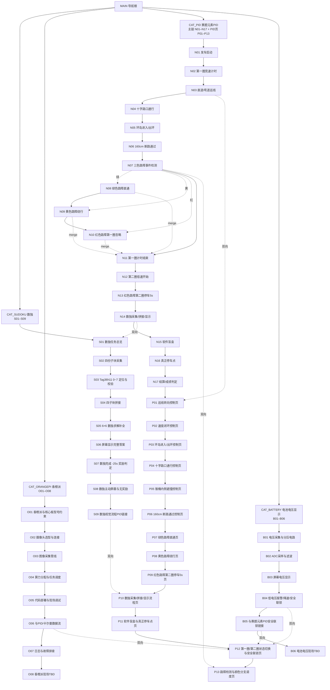
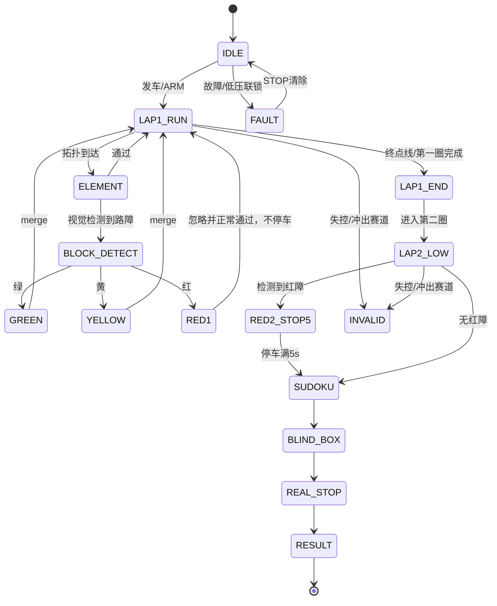
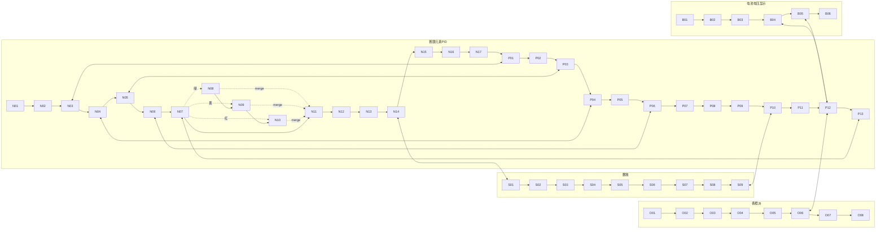

# NEUQ智能车校赛链表式目录（Linked-list Index）及PID页面索引

> 版本：v0.1（初版，随赛题初版同步）
> 适用：第21届 H 方案白色 PVC 赛道，45 cm 宽，总长 55.061 m，外廓 7.283 m × 5.45 m
> 规则基准：本手册“路障第一圈不可屏蔽”覆盖原 PDF“三色路障可主动选择屏蔽”的表述；**以本修订版为准**。
> 代码骨架：`CODE/Car_menu.c`、`CODE/Car_menu.h`、`CODE/key.c`、`CODE/key.h`

---

## 1. 修订说明与冲突标注

1. **冲突覆盖**：原 PDF 中“三色路障可主动选择屏蔽”的表述，**被本修订版“路障第一圈不可屏蔽”覆盖**。凡涉及路障屏蔽，均以本修订版为准。
2. 一级目录固定四类，不得增加第五类：**数独、香橙派、赛题元素PID、电池电压显示**。
3. 红障第一圈“忽略并正常通过”**不等于屏蔽**：不得停车、不得跳转、不得按屏蔽计罚。
4. 路障位置现场公布，目录中不写死拓扑位置；采用“拓扑主链 + 颜色事件分支 + merge 回主链”。
5. 现场未知信息统一标 **TBD / 待现场确认**，不臆造。
6. 每个“赛题元素PID”页面强制包含“卡尔曼滤波参数调节”小节，即使该元素不适用也要写原因与替代滤波。

---

## 2. 一级目录总表

| 一级分类 | 二级页面/节点 | 链表入口 | 说明 |
|---|---|---|---|
| 数独 | S01–S09 | S01 | 由 N14 与 P10 双向链接进入；四子块、Tag、拼接、求解、显示、奖励/屏蔽 |
| 香橙派 | O01–O08 | O01 | 型号/摄像头/采集/调度/部署/数据流/日志/TBD |
| 赛题元素PID | N01–N17（主链）+ P01–P13（PID页） | N01 | 每个得分/罚时元素独立 PID 或流程页；P01–P13 为索引 |
| 电池电压显示 | B01–B06 | B01 | 分压、ADC、显示、低压报警/降速/联锁；B04/B05 链接 P12 |

**链表入口关系**：`N01 → … → N17 → P01 → … → P13`；`N14 ↔ S01`；`S09 ↔ P10`；`B04/B05 ↔ P12`；`O06 ↔ P12`。

---

## 3. 链表节点总表

> 代码中的 `MenuID` 还包含 `MAIN` 与 `CAT_*` 五个导航页；下表只列 53 个竞赛节点。

> 分类缩写：数独 / 香橙派 / 赛题PID / 电池。类型缩写：基本 / 得分 / 罚时 / 规则 / 硬件 / TBD / 子流程。圈：1=第一圈，2=第二圈，全=全程。卡尔曼：是 / 否 / 间接。

| ID | 名称 | 分类 | 类型 | 可屏蔽 | 圈 | 得分/罚时 | prev | next | pid_page | 卡尔曼 | 状态 |
|---|---|---|---|---|---|---|---|---|---|---|---|
| N01 | 发车启动 | 赛题PID | 基本 | 否 | 1 | — | — | N02 | — | 否 | 已确认 |
| N02 | 第一圈竞速计时 | 赛题PID | 规则 | 否 | 1 | 基准 | N01 | N03 | [[PID-12_第一圈第二圈状态切换与安全联锁页]] | 否 | 已确认 |
| N03 | 直道/弯道巡线 | 赛题PID | 基本 | 否 | 全 | — | N02 | N04 | [[PID-01_巡线转向控制页]] | 是 | 已确认 |
| N04 | 十字路口通行 | 赛题PID | 基本 | 否 | 全 | 走错酌情 TBD | N03 | N05 | [[PID-04_十字路口通行控制页]] | 间接 | 已确认 |
| N05 | 环岛进入/出环 | 赛题PID | 基本 | 否 | 全 | 没进 +45s | N04 | N06 | [[PID-03_环岛进入出环控制页]] | 是 | 已确认 |
| N06 | 160cm 断路通过 | 赛题PID | 基本 | 否 | 全 | 失败成绩无效 | N05 | N07 | [[PID-06_160cm断路通过控制页]] | 间接 | 已确认 |
| N07 | 三色路障事件检测 | 赛题PID | 子流程 | **否** | 全 | 每个未完成/错误 +10s | N06 | N11 | [[PID-13_路障检测与颜色分支调度页]] | 否 | 已确认 |
| N08 | 绿色路障直通 | 赛题PID | 基本 | **否** | 1 | 错误 +10s | — | N09 | [[PID-07_绿色路障直通页]] | 否 | 已确认 |
| N09 | 黄色路障绕行 | 赛题PID | 罚时 | **否** | 1 | 错误 +10s；撞锥桶 +15s | N08 | N10 | [[PID-08_黄色路障绕行页]] | 否 | 已确认 |
| N10 | 红色路障第一圈忽略 | 赛题PID | 罚时 | **否** | 1 | 错误 +10s | N09 | — | [[PID-09_红色路障第二圈停车5s页]] | 否 | 已确认 |
| N11 | 第一圈计时结束 | 赛题PID | 规则 | 否 | 1 | — | N07 | N12 | [[PID-12_第一圈第二圈状态切换与安全联锁页]] | 否 | 已确认 |
| N12 | 第二圈低速开始 | 赛题PID | 规则 | 否 | 2 | — | N11 | N13 | [[PID-12_第一圈第二圈状态切换与安全联锁页]] | 间接 | 已确认 |
| N13 | 红色路障第二圈停车5s | 赛题PID | 罚时 | **否** | 2 | 未停 +10s（TBD） | N12 | N14 | [[PID-09_红色路障第二圈停车5s页]] | 否 | 已确认 |
| N14 | 数独采集/拼接/显示 | 数独 | 得分 | 是 | 2 | 完成 -25s | N13 | N15 | [[PID-10_数独采集拼接显示流程页]] | 间接 | 已确认 |
| N15 | 软件盲盒 | 赛题PID | 罚时 | 部分 | 2 | 未完成 +20s | N14 | N16 | [[PID-11_软件盲盒与真正停车点页]] | 否 | 现场 |
| N16 | 真正停车点 | 赛题PID | 基本 | 否 | 2 | — | N15 | N17 | [[PID-11_软件盲盒与真正停车点页]] | 否 | 现场 |
| N17 | 结算/成绩判定 | 赛题PID | 规则 | 否 | 全 | — | N16 | P01 | — | 否 | 已确认 |
| S01 | 数独任务总览 | 数独 | 得分 | 是 | 2 | 完成 -25s | — | S02 | [[PID-10_数独采集拼接显示流程页]] | 间接 | 已确认 |
| S02 | 四份子块采集 | 数独 | 子流程 | 是 | 2 | -25s 前置 | S01 | S03 | [[PID-10_数独采集拼接显示流程页]] | 间接 | 已确认 |
| S03 | Tag36h11 0~7 定位与校验 | 数独 | 规则 | 是 | 2 | -25s 前置 | S02 | S04 | [[PID-10_数独采集拼接显示流程页]] | 间接 | 已确认 |
| S04 | 四子块拼接 | 数独 | 子流程 | 是 | 2 | -25s 前置 | S03 | S05 | [[PID-10_数独采集拼接显示流程页]] | 间接 | 已确认 |
| S05 | 6×6 数独求解补全 | 数独 | 子流程 | 是 | 2 | -25s 前置 | S04 | S06 | [[PID-10_数独采集拼接显示流程页]] | 间接 | 已确认 |
| S06 | 屏幕显示完整答案 | 数独 | 子流程 | 是 | 2 | -25s 前置 | S05 | S07 | [[PID-10_数独采集拼接显示流程页]] | 间接 | 已确认 |
| S07 | 数独完成 -25s 奖励判定 | 数独 | 得分 | 是 | 2 | -25s | S06 | S08 | [[PID-10_数独采集拼接显示流程页]] | 间接 | 已确认 |
| S08 | 数独主动屏蔽与无奖励 | 数独 | 规则 | 是 | 2 | 无奖励 | S07 | S09 | [[PID-10_数独采集拼接显示流程页]] | 否 | 已确认 |
| S09 | 数独视觉流程PID链接 | 数独 | 子流程 | 是 | 2 | — | S08 | — | [[PID-10_数独采集拼接显示流程页]] | 间接 | 已确认 |
| O01 | 香橙派与核心板型号约束 | 香橙派 | 硬件 | 否 | 全 | — | — | O02 | — | 否 | 已确认 |
| O02 | 摄像头选型与连接 | 香橙派 | 硬件 | 否 | 全 | — | O01 | O03 | — | 否 | 已确认 |
| O03 | 图像采集管线 | 香橙派 | 子流程 | 否 | 全 | — | O02 | O04 | [[PID-10_数独采集拼接显示流程页]] | 间接 | 已确认 |
| O04 | 算力分配与任务调度 | 香橙派 | 子流程 | 否 | 全 | — | O03 | O05 | — | 否 | 已确认 |
| O05 | 代码部署与现场调试 | 香橙派 | 子流程 | 否 | 全 | — | O04 | O06 | — | 否 | 已确认 |
| O06 | 与PID/卡尔曼数据流 | 香橙派 | 子流程 | 否 | 全 | — | O05 | O07 | [[PID-12_第一圈第二圈状态切换与安全联锁页]] | 间接 | 已确认 |
| O07 | 日志与故障排查 | 香橙派 | 子流程 | 否 | 全 | — | O06 | O08 | — | 否 | 已确认 |
| O08 | 香橙派现场TBD | 香橙派 | TBD | 否 | 全 | — | O07 | — | — | 否 | TBD |
| P01 | 巡线转向控制页 | 赛题PID | 子流程 | 否 | 全 | — | N17 | P02 | [[PID-01_巡线转向控制页]] | 是 | 已确认 |
| P02 | 速度闭环控制页 | 赛题PID | 子流程 | 否 | 全 | — | P01 | P03 | [[PID-02_速度闭环控制页]] | 间接 | 已确认 |
| P03 | 环岛进入/出环控制页 | 赛题PID | 子流程 | 否 | 全 | — | P02 | P04 | [[PID-03_环岛进入出环控制页]] | 是 | 已确认 |
| P04 | 十字路口通行控制页 | 赛题PID | 子流程 | 否 | 全 | — | P03 | P05 | [[PID-04_十字路口通行控制页]] | 间接 | 已确认 |
| P05 | 锥桶内侧避撞控制页 | 赛题PID | 子流程 | 否 | 全 | 撞锥桶 +15s | P04 | P06 | [[PID-05_锥桶内侧避撞控制页]] | 是 | TBD |
| P06 | 160cm 断路通过控制页 | 赛题PID | 子流程 | 否 | 全 | — | P05 | P07 | [[PID-06_160cm断路通过控制页]] | 间接 | 已确认 |
| P07 | 绿色路障直通页 | 赛题PID | 子流程 | 否 | 1 | — | P06 | P08 | [[PID-07_绿色路障直通页]] | 否 | 已确认 |
| P08 | 黄色路障绕行页 | 赛题PID | 子流程 | 否 | 1 | — | P07 | P09 | [[PID-08_黄色路障绕行页]] | 是 | 已确认 |
| P09 | 红色路障第二圈停车5s页 | 赛题PID | 子流程 | 否 | 2 | — | P08 | P10 | [[PID-09_红色路障第二圈停车5s页]] | 否 | 已确认 |
| P10 | 数独采集/拼接/显示流程页 | 赛题PID | 子流程 | 是 | 2 | -25s | P09 | P11 | [[PID-10_数独采集拼接显示流程页]] | 间接 | 已确认 |
| P11 | 软件盲盒与真正停车点页 | 赛题PID | 子流程 | 部分 | 2 | +20s | P10 | P12 | [[PID-11_软件盲盒与真正停车点页]] | 否 | 现场 |
| P12 | 第一圈/第二圈状态切换与安全联锁页 | 赛题PID | 子流程 | 否 | 全 | — | P11 | P13 | [[PID-12_第一圈第二圈状态切换与安全联锁页]] | 间接 | 已确认 |
| P13 | 路障检测与颜色分支调度页 | 赛题PID | 子流程 | 否 | 全 | — | P12 | — | [[PID-13_路障检测与颜色分支调度页]] | 否 | 已确认 |
| B01 | 电压采集与分压电路 | 电池 | 硬件 | 否 | 全 | — | — | B02 | — | 否 | 已确认 |
| B02 | ADC采样与滤波 | 电池 | 子流程 | 否 | 全 | — | B01 | B03 | — | 间接 | 已确认 |
| B03 | 屏幕电压显示 | 电池 | 子流程 | 否 | 全 | — | B02 | B04 | — | 间接 | 已确认 |
| B04 | 低电压报警/降速/安全联锁 | 电池 | 规则 | 否 | 全 | — | B03 | B05 | [[PID-12_第一圈第二圈状态切换与安全联锁页]] | 间接 | 已确认 |
| B05 | 与赛题元素PID安全联锁链接 | 电池 | 子流程 | 否 | 全 | — | B04 | B06 | [[PID-12_第一圈第二圈状态切换与安全联锁页]] | 间接 | 已确认 |
| B06 | 电池电压现场TBD | 电池 | TBD | 否 | 全 | — | B05 | — | — | 否 | TBD |

---

## 3.1 节点树状图（Mermaid）



## 3.2 节点树状图（ASCII）

> `MAIN` 和 `CAT_*` 是导航页面，不计入 53 个竞赛节点，也不构成第五个一级分类。

```text
MAIN 导航根
├─ CAT_SUDOKU 数独（S01–S09）
│  ├─ S01 数独任务总览
│  ├─ S02 四份子块采集
│  ├─ S03 Tag36h11 0~7 定位与校验
│  ├─ S04 四子块拼接
│  ├─ S05 6×6 数独求解补全
│  ├─ S06 屏幕显示完整答案
│  ├─ S07 数独完成 -25s 奖励判定
│  ├─ S08 数独主动屏蔽与无奖励
│  └─ S09 数独视觉流程PID链接
├─ CAT_ORANGEPI 香橙派（O01–O08）
│  ├─ O01 香橙派与核心板型号约束
│  ├─ O02 摄像头选型与连接
│  ├─ O03 图像采集管线
│  ├─ O04 算力分配与任务调度
│  ├─ O05 代码部署与现场调试
│  ├─ O06 与PID/卡尔曼数据流
│  ├─ O07 日志与故障排查
│  └─ O08 香橙派现场TBD
├─ CAT_PID 赛题元素PID
│  ├─ 主链（N01–N17）
│  │  ├─ N01 发车启动
│  │  ├─ N02 第一圈竞速计时
│  │  ├─ N03 直道/弯道巡线
│  │  ├─ N04 十字路口通行
│  │  ├─ N05 环岛进入/出环
│  │  ├─ N06 160cm 断路通过
│  │  ├─ N07 三色路障事件检测
│  │  │  ├─ N08 绿色路障直通
│  │  │  ├─ N09 黄色路障绕行
│  │  │  └─ N10 红色路障第一圈忽略
│  │  ├─ N11 第一圈计时结束
│  │  ├─ N12 第二圈低速开始
│  │  ├─ N13 红色路障第二圈停车5s
│  │  ├─ N14 数独采集/拼接/显示
│  │  ├─ N15 软件盲盒
│  │  ├─ N16 真正停车点
│  │  └─ N17 结算/成绩判定
│  └─ PID 页面索引（P01–P13）
│     ├─ P01 巡线转向控制页
│     ├─ P02 速度闭环控制页
│     ├─ P03 环岛进入/出环控制页
│     ├─ P04 十字路口通行控制页
│     ├─ P05 锥桶内侧避撞控制页
│     ├─ P06 160cm 断路通过控制页
│     ├─ P07 绿色路障直通页
│     ├─ P08 黄色路障绕行页
│     ├─ P09 红色路障第二圈停车5s页
│     ├─ P10 数独采集/拼接/显示流程页
│     ├─ P11 软件盲盒与真正停车点页
│     ├─ P12 第一圈/第二圈状态切换与安全联锁页
│     └─ P13 路障检测与颜色分支调度页
└─ CAT_BATTERY 电池电压显示（B01–B06）
   ├─ B01 电压采集与分压电路
   ├─ B02 ADC采样与滤波
   ├─ B03 屏幕电压显示
   ├─ B04 低电压报警/降速/安全联锁
   ├─ B05 与赛题元素PID安全联锁链接
   └─ B06 电池电压现场TBD
```

---

## 4. 主链清单

```
N01 发车
 → N02 第一圈竞速计时
 → N03 直道/弯道巡线
 → N04 十字路口
 → N05 环岛
 → N06 160cm断路
 → N07 三色路障事件检测
      ├─ 绿 → N08 直通 ─┐
      ├─ 黄 → N09 绕行 ─┼─ merge → N11
      ├─ 红 → N10 第一圈忽略 ─┘
      └─ 未检测到 → N11
 → N11 第一圈计时结束
 → N12 第二圈低速开始
 → N13 红障第二圈停车5s
 → N14 数独采集/拼接/显示
 → N15 软件盲盒
 → N16 真正停车点
 → N17 结算
```

说明：
- N07 是**事件触发检查点**，不是固定位置节点；表中 `next=N11` 是模板主链顺序，实际比赛由颜色识别在任意拓扑段插入，`merge_to` 指回主链当前位置。
- 路障位置不硬编码；第二圈是否复现/屏蔽按现场策略 TBD。
- N14 与数独目录双向链接：`N14 ↔ S01`。

---

## 4.1 建链规则（Link-building）

> 代码参考提交的菜单框架：`MenuID` 统一编号，`MenuConfig.parent_id` 描述层级，`Car_Menu_BuildLink()` 在运行时建链。一级目录仍固定四类；`MAIN` 只是导航根页面，不是第五类。

### 4.1.1 枚举格式

```c
typedef enum {
    MENU_NONE = -1,   /* 空链接/无父节点 */
    MAIN = 0,         /* 导航根 */
    CAT_SUDOKU, CAT_ORANGEPI, CAT_PID, CAT_BATTERY,
    S01, /* ... */ S09,
    O01, /* ... */ O08,
    N01, /* ... */ N17,
    P01, /* ... */ P13,
    B01, /* ... */ B06,
    MENU_COUNT
} MenuID;
```

- `MENU_NONE = -1` 表示无父节点/无链接；
- `MAIN = 0` 是导航根；
- 枚举顺序决定同级节点的初始排列顺序；
- `MENU_COUNT` 是节点总数（当前 58）。

### 4.1.2 配置表字段

| 字段 | 含义 | 建链作用 |
|---|---|---|
| `name` | ASCII 显示名 | 页面标题 |
| `parent_id` | 父节点编号 | **建链的唯一层级依据** |
| `value` | 可编辑参数地址 | 非空表示可编辑；`NULL` 表示纯页面 |
| `min/max/step` | 编辑范围/步长 | 编辑模式限幅 |
| `pid_link` | 跨目录链接 | 元数据，不参与父子建链 |
| `type/skippable/lap/score/kalman/status` | 竞赛元数据 | 不参与建链 |

### 4.1.3 建链步骤

1. 清空 `nodes[MENU_COUNT]`，把每个节点的 `info` 指向 `MenuTable[i]`；
2. 遍历 `i = 0..MENU_COUNT-1`，若 `parent_id != MENU_NONE`，把节点挂到父节点的 child 链；
3. 同级链是**环形双向链表**：第一个子节点的 `prev/next` 指向自己；后续节点插到表尾；
4. `MAIN` 是唯一根；`CAT_*` 是四个一级目录；竞赛节点挂在对应目录下；
5. `N07` 的子节点为 `N08/N09/N10`，形成路障颜色分支子链；
6. `CAT_PID` 的同级顺序为 `N01..N07、N11..N17、P01..P13`。

### 4.1.4 建链不变量（自检项）

| 不变量 | 检查 |
|---|---|
| 根唯一 | 只有 `MAIN` 的 `parent_id == MENU_NONE` |
| 父指针一致 | `nodes[i].parent == &nodes[parent_id]` |
| 同级链环形 | 首节点 `prev/next` 自指，尾节点 `next` 回首节点 |
| 父链可达 MAIN | 每个非 MAIN 节点沿 parent 最终到达 MAIN |
| 无环/无自引用 | 深度不超过 `MENU_COUNT`，`parent_id != i` |
| 编辑范围合法 | `value != NULL` 时 `min <= max` 且 `step > 0` |
| pid_link 有效 | 非 `MENU_NONE` 时落在 0..MENU_COUNT-1 |

### 4.1.5 伪代码

```text
for i in 0..MENU_COUNT-1:
    nodes[i].info = &MenuTable[i]
    clear parent/child/prev/next

for i in 0..MENU_COUNT-1:
    if MenuTable[i].parent_id == MENU_NONE: continue
    parent = &nodes[parent_id]
    if parent.child == NULL:
        parent.child = node
        node.prev = node.next = node
    else:
        last = parent.child.prev
        node.prev = last; last.next = node
        node.next = parent.child; parent.child.prev = node
```

### 4.1.6 代码位置

- `CODE/Car_menu.h`：`MenuID`、`MenuConfig`、`CarMenuParams`；
- `CODE/Car_menu.c`：`MenuTable[]`、`Car_Menu_BuildLink()`、`Car_Menu_ValidateLinks()`；
- 建链后 `page = &nodes[MAIN]`、`selected = page->child`；
- `Car_Menu_Init()` 自动执行建链和自检；`Car_Menu_LinkErrorCount()` 返回错误数。

## 4.2 编辑与浏览

### 4.2.1 状态

| 变量 | 含义 |
|---|---|
| `page` | 当前页面 |
| `selected` | 当前选中项，永远是 `page` 的子节点 |
| `editing` | 0 浏览，1 编辑 |
| `edit_value` | 编辑中的临时值 |

### 4.2.2 按键映射

| 模式 | 按键 | 动作 |
|---|---|---|
| 浏览 | UP/DOWN 单击或长按重复 | 同级 `prev/next`，环形回绕 |
| 浏览 | OK 单击 | 有子节点则进入；否则 `value != NULL` 则进入编辑 |
| 浏览 | OK 双击 / BACK 单击 | 返回父页面 |
| 浏览 | OK 长按 / BACK 长按 | 回到 MAIN |
| 编辑 | UP/DOWN 单击或长按重复 | `edit_value ± step`，按 min/max 限幅 |
| 编辑 | OK 单击/长按 | 提交 `*value = edit_value`，退出编辑 |
| 编辑 | OK 双击 / BACK 单击 | 取消，退出编辑 |

按键引脚按提交的 `NEUQ_KEY.h` 和核心板 J2 排针：**PE10 / PE8 / PE7 / PE9**，低电平有效。

### 4.2.3 可编辑参数

`CarMenuParams` 当前包含：
`pid_kp / pid_ki / pid_kd`、`kalman_q / kalman_r`、`lap_mode`、`speed_limit`、`ring_speed`、`cone_offset`、`red_stop_s`、`gap_speed`、`battery_low`。

对应页面：P01、P02、P03、P04、P05、P06、P08、P09、P12、N12、B04；其余节点 `value = NULL`，只浏览。

### 4.2.4 显示层

LCD200 默认 `LCD200_DIR_Cross` 是 **320x240 横屏**；原 17 行竖屏布局超过 240 像素高度，属于显示 bug，已暂时删除渲染代码（`Car_Menu_Render()` 为空实现）。建链、浏览、编辑逻辑不依赖 LCD；显示层按横屏重新设计后再恢复。

## 5. 分支/屏蔽/失败跳转表

| 节点/事件 | 触发 | branch_to | merge_to | on_skip | on_fail |
|---|---|---|---|---|---|
| N07 路障检测 | 视觉颜色识别（位置现场公布） | N08/N09/N10（按颜色） | N11 | **第一圈禁止屏蔽；不得跳转** | 识别失败：停车重试/人工复位；不得跳过 |
| N08 绿障 | 绿颜色 | — | N11 | **禁止屏蔽；不得跳转** | 未正确直通/误触：+10s |
| N09 黄障 | 黄颜色 | — | N11 | **禁止屏蔽；不得跳转** | 触碰/碾压：+10s；撞蓝锥桶：+15s（叠加规则 TBD） |
| N10 红障第一圈 | 红颜色 | — | N11 | **禁止屏蔽；不得跳转** | 误停/未正常通过：+10s；第一圈必须忽略并正常通过 |
| N13 红障第二圈 | 红颜色 | — | N14 | 第一圈结论不适用于第二圈；第二圈策略 TBD | 未停车 5s：+10s（TBD） |
| N05 环岛 | 拓扑到达 | P03 | N06 | 禁止屏蔽 | 没进环岛：+45s；失败重试/终止 |
| N06 160cm 断路 | 拓扑到达 | P06 | N07 | 禁止屏蔽 | 冲出/未通过：成绩无效/救援 |
| N04 十字 | 拓扑到达 | P04 | N05 | 禁止屏蔽 | 走错：酌情罚时（TBD） |
| N14 数独 | Tag/视觉 | P10 | N15 | 主动屏蔽：无 -25s 奖励，不罚时（TBD 确认） | 未完成/无法显示：无奖励，不罚时 |
| N15 盲盒 | 现场公布 | P11 | N16 | 按未完成 +20s | 未完成 +20s |
| N16 真停车点 | 现场公布 | P11 | N17 | 禁止屏蔽 | 未停/停错：TBD（建议按未完成处理） |
| S08 数独屏蔽 | 人工/现场 | — | S09 | 无奖励，不罚时 | — |
| 第二圈路障屏蔽 | 现场策略 | — | — | 若屏蔽：每个 +10s；不影响第一圈不可屏蔽结论 | — |

**关键结论**：第一圈 N07–N10、N13 的 `on_skip` 均为“禁止屏蔽；不得跳转”；红障第一圈 `on_skip` 不是屏蔽，而是“忽略并正常通过”。

---

## 6. PID 页面索引表

| 页面ID | 对应节点 | 一级分类 | 控制类型 | 含卡尔曼 | 关键验收指标 |
|---|---|---|---|---|---|
| [[PID-01_巡线转向控制页]] | N03 | 赛题元素PID | 状态机+PID | 是 | 横向误差、单圈不冲出、通过时间 |
| [[PID-02_速度闭环控制页]] | N03/N12 | 赛题元素PID | 纯PID | 间接 | 阶跃响应、稳态误差、限幅/抗饱和 |
| [[PID-03_环岛进入出环控制页]] | N05 | 赛题元素PID | 状态机+PID | 是 | 进环/出环成功率、+45s 风险 |
| [[PID-04_十字路口通行控制页]] | N04 | 赛题元素PID | 状态机+PID | 间接 | 直行/转弯判定、误判率、罚时 |
| [[PID-05_锥桶内侧避撞控制页]] | N09/P05 | 赛题元素PID | 状态机+PID | 是 | 锥桶间距、避撞成功率、+15s 风险 |
| [[PID-06_160cm断路通过控制页]] | N06 | 赛题元素PID | 状态机+PID | 间接 | 断路通过率、冲出次数、成绩无效风险 |
| [[PID-07_绿色路障直通页]] | N08 | 赛题元素PID | 视觉流程 | 否 | 颜色识别率、直通成功率、+10s 风险 |
| [[PID-08_黄色路障绕行页]] | N09 | 赛题元素PID | 状态机+PID | 是 | 绕行轨迹、触碰/碾压次数、+15s 风险 |
| [[PID-09_红色路障第二圈停车5s页]] | N10/N13 | 赛题元素PID | 状态机 | 否 | 停车时长、起步成功率、+10s 风险 |
| [[PID-10_数独采集拼接显示流程页]] | N14/S01–S09 | 赛题元素PID | 视觉流程 | 间接 | 四块完整率、Tag 校验、-25s |
| [[PID-11_软件盲盒与真正停车点页]] | N15/N16 | 赛题元素PID | 状态机 | 否 | 盲盒完成率、真停车点命中、+20s |
| [[PID-12_第一圈第二圈状态切换与安全联锁页]] | N02/N11/N12/N17/B04/B05 | 赛题元素PID | 状态机 | 间接 | 圈次切换正确性、联锁触发、无越权启动 |
| [[PID-13_路障检测与颜色分支调度页]] | N07 | 赛题元素PID | 视觉流程 | 否 | 颜色识别率、分支/merge 正确性、+10s |

---

## 7. 每个 PID 页面的骨架清单

> 每页强制包含“卡尔曼滤波参数调节”。参数具体数值未给出的统一写 TBD。

### PID-01 巡线转向控制页
- 页面ID/双向链接：[[PID-01_巡线转向控制页]] ↔ N03、P02、P12
- 对应节点：N03｜分类：赛题元素PID｜任务：巡线转向
- 控制目标/期望值：横向误差 e_y→0，航向误差 e_θ→0；期望曲率由视觉给出
- 反馈源：摄像头中心线/曲率、编码器、IMU（可选）
- 执行器/输出限幅：左右轮差速 PWM，±CAR_PWM_LIMIT；转向增量限幅 TBD
- PID适用性：状态机+PID（直道/弯道/连续弯分段）
- PID参数表：Kp/Ki/Kd/死区/积分限幅/输出限幅/采样周期/抗饱和 = TBD；采样 5 ms
- 调参步骤：架空→低速直道→弯道→连续弯→环岛接口；先 P 后 D，I 最后
- 验收指标：单圈不冲出；横向误差/通过时间 TBD；失败回退低速/停车
- 关联罚时/奖励：冲出赛道成绩无效；撞蓝锥桶 +15s
- TBD：摄像头安装角、曲率标定、转向限幅
- **卡尔曼滤波参数调节**
  1) 是否使用：是
  2) 状态量/观测量：[e_y, e_θ, v] / [e_y, e_θ]
  3) F/H 简化：匀速模型+曲率输入；H 取前两维
  4) Q/R/P 调节表：Q=diag(TBD)、R=diag(TBD)、P0=diag(TBD)
  5) 频率关系：视觉 20~50 Hz，PID 200 Hz（5 ms）
  6) 进入PID方式：滤波后的 e_y/e_θ 进入反馈，原始值仅做保护
  7) 调参顺序：先 R（视觉噪声）后 Q（模型信任）；日志看残差/协方差
  8) 异常保护：发散/延迟/跳变 → 一阶低通 + 降速 + 停车联锁
  9) 验收：延迟/抖动/误判率 TBD
  10) 不适用时：一阶低通/中值滤波替代

### PID-02 速度闭环控制页
- 页面ID/双向链接：[[PID-02_速度闭环控制页]] ↔ N03/N12、P12
- 对应节点：N03/N12｜分类：赛题元素PID｜任务：速度闭环
- 控制目标：左右轮速跟随目标；稳态误差→0，超调/换向冲击受限
- 反馈源：编码器输出轴转速（滤波后）、目标加速度/加加速度
- 执行器/输出限幅：PWM ±CAR_PWM_LIMIT；积分限幅 TBD；抗饱和=积分分离/回算
- PID适用性：纯PID（位置式或增量式，按现有 Car_PID 实现）
- PID参数表：Kp=2.0、Ki=0.12、Kd=0.0（当前 Car_Config 默认，待整车辨识）；死区/积分限幅/输出限幅/采样周期 5 ms/TBD
- 调参步骤：架空→单轮阶跃→双轮同步→低速巡线→高速巡线
- 验收指标：阶跃上升时间、超调、稳态误差、堵转保护
- 关联罚时/奖励：速度是基准成绩；失控冲出成绩无效
- TBD：真实 CPR、减速比、前馈 Ks/Kv/Ka
- **卡尔曼滤波参数调节**
  1) 是否使用：间接（可选轮速融合/打滑抑制）
  2) 状态量/观测量：[v, a] / 编码器 v
  3) F/H：匀加速模型；H=[1,0]
  4) Q/R/P：Q=diag(TBD)、R=TBD、P0=diag(TBD)
  5) 频率关系：与控制周期 5 ms 一致或 2 倍降采样
  6) 进入PID方式：滤波 v 作为速度环反馈；原始 v 仅做堵转判断
  7) 调参顺序：先 R 后 Q；低速/高速分别看残差
  8) 异常保护：发散/延迟 → 回退现有一阶低通 CAR_SPEED_FILTER_TAU_S
  9) 验收：延迟、抖动、打滑误判率 TBD
  10) 不适用时：编码器差分 + 一阶低通（现方案）

### PID-03 环岛进入/出环控制页
- 页面ID/双向链接：[[PID-03_环岛进入出环控制页]] ↔ N05、P01/P04/P12
- 对应节点：N05｜分类：赛题元素PID｜任务：环岛状态机
- 控制目标：进环、环内保持、出环三态正确切换；不压环岛边线
- 反馈源：摄像头环岛特征/曲率、编码器、IMU
- 执行器/输出限幅：差速 PWM；环内速度上限 TBD；转向限幅 TBD
- PID适用性：状态机+PID
- PID参数表：Kp/Ki/Kd/死区/积分限幅/输出限幅/5 ms/TBD
- 调参步骤：静止状态机→低速进环→环内→出环→连续两次
- 验收指标：进环成功率、出环成功率、+45s 风险
- 关联罚时/奖励：环岛没进 +45s
- TBD：环岛方向、出入口判定阈值、现场元素顺序
- **卡尔曼滤波参数调节**
  1) 是否使用：是
  2) 状态量/观测量：[e_y, e_θ, κ] / [e_y, e_θ]
  3) F/H：曲率驱动的匀速模型；H 取误差维
  4) Q/R/P：Q=diag(TBD)、R=diag(TBD)、P0=diag(TBD)
  5) 频率关系：视觉帧同步，PID 5 ms
  6) 进入PID方式：滤波误差进入转向环；κ 用于前馈
  7) 调参顺序：先 R 后 Q；重点看环岛入口残差
  8) 异常保护：发散/延迟 → 退出环岛状态并降速
  9) 验收：进/出环延迟、误判率 TBD
  10) 不适用时：曲率中值滤波 + 状态机滞回

### PID-04 十字路口通行控制页
- 页面ID/双向链接：[[PID-04_十字路口通行控制页]] ↔ N04、P01/P12
- 对应节点：N04｜分类：赛题元素PID｜任务：十字通行
- 控制目标：直行/转弯判定正确，不误入支路；通过时间稳定
- 反馈源：摄像头十字特征、编码器、IMU、计时
- 执行器/输出限幅：差速 PWM；通过速度上限 TBD
- PID适用性：状态机+PID
- PID参数表：Kp/Ki/Kd/死区/积分限幅/输出限幅/5 ms/TBD
- 调参步骤：低速直行→低速转弯→高速直行→连续十字
- 验收指标：走错次数、通过时间、罚时风险
- 关联罚时/奖励：十字走错酌情罚时（TBD）
- TBD：十字识别阈值、走错罚时细则
- **卡尔曼滤波参数调节**
  1) 是否使用：间接
  2) 状态量/观测量：[e_y, e_θ] / 视觉中心线
  3) F/H：匀速模型；H=[I]
  4) Q/R/P：Q=diag(TBD)、R=diag(TBD)、P0=diag(TBD)
  5) 频率关系：视觉 20~50 Hz，PID 5 ms
  6) 进入PID方式：滤波误差进入转向环，原始值做十字标志保护
  7) 调参顺序：先 R 后 Q；看十字前后残差跳变
  8) 异常保护：跳变 → 冻结状态机 + 降速
  9) 验收：误判率/延迟 TBD
  10) 不适用时：中值滤波 + 连续帧投票

### PID-05 锥桶内侧避撞控制页
- 页面ID/双向链接：[[PID-05_锥桶内侧避撞控制页]] ↔ N09、P08/P12
- 对应节点：N09/P05｜分类：赛题元素PID｜任务：锥桶内侧避撞
- 控制目标：绕行时与蓝锥桶保持安全间距，不撞桶
- 反馈源：摄像头锥桶检测/测距、编码器、IMU
- 执行器/输出限幅：差速 PWM；绕行横向偏移限幅 TBD
- PID适用性：状态机+PID
- PID参数表：Kp/Ki/Kd/死区/积分限幅/输出限幅/5 ms/TBD
- 调参步骤：静态锥桶→低速绕行→高速绕行→黄障组合
- 验收指标：最小间距、撞桶次数、+15s 风险
- 关联罚时/奖励：撞蓝色小锥桶 +15s
- TBD：锥桶布局、允许离开赛道范围、黄障与锥桶关系
- **卡尔曼滤波参数调节**
  1) 是否使用：是
  2) 状态量/观测量：[x, y, vx, vy] / 锥桶像素→地面坐标
  3) F/H：匀速模型；H 取位置维
  4) Q/R/P：Q=diag(TBD)、R=diag(TBD)、P0=diag(TBD)
  5) 频率关系：视觉帧同步，PID 5 ms
  6) 进入PID方式：滤波位置→横向偏移目标→转向环
  7) 调参顺序：先 R 后 Q；看锥桶跟踪残差
  8) 异常保护：丢帧/发散 → 退出绕行并降速停车
  9) 验收：测距延迟、抖动、误检率 TBD
  10) 不适用时：单帧检测 + 中值滤波 + 保守降速

### PID-06 160cm 断路通过控制页
- 页面ID/双向链接：[[PID-06_160cm断路通过控制页]] ↔ N06、P01/P12
- 对应节点：N06｜分类：赛题元素PID｜任务：断路直道通过
- 控制目标：保持直行姿态平稳通过 160cm 无边界区域，不冲出
- 反馈源：摄像头远端参考、编码器航迹推算、IMU 航向
- 执行器/输出限幅：差速 PWM；通过速度上限 TBD；航向修正限幅
- PID适用性：状态机+PID（视觉丢失时航向保持）
- PID参数表：Kp/Ki/Kd/死区/积分限幅/输出限幅/5 ms/TBD
- 调参步骤：低速直行→断路入口→断路中段→出口→连续两次
- 验收指标：通过时间、横向漂移、冲出次数（成绩无效风险）
- 关联罚时/奖励：失败成绩无效
- TBD：断路入口/出口识别方式、允许速度、应急停车策略
- **卡尔曼滤波参数调节**
  1) 是否使用：间接（航向/位置融合）
  2) 状态量/观测量：[θ, v, ω] / IMU 角速度、编码器
  3) F/H：航向匀速模型；H 取 θ
  4) Q/R/P：Q=diag(TBD)、R=TBD、P0=diag(TBD)
  5) 频率关系：IMU/编码器 5 ms，视觉辅助 TBD
  6) 进入PID方式：滤波航向进入转向环；视觉恢复后重置
  7) 调参顺序：先 R 后 Q；看断路中段漂移
  8) 异常保护：发散/延迟 → 切纯航向保持并降速
  9) 验收：漂移量、通过率 TBD
  10) 不适用时：互补滤波/IMU 直接积分 + 死区

### PID-07 绿色路障直通页
- 页面ID/双向链接：[[PID-07_绿色路障直通页]] ↔ N08、P13
- 对应节点：N08｜分类：赛题元素PID｜任务：绿障直通
- 控制目标：识别绿色→保持中线直接通过，不绕行、不停车
- 反馈源：摄像头颜色识别、中心线
- 执行器/输出限幅：沿用巡线转向/速度环
- PID适用性：视觉流程（不新增独立PID环）
- PID参数表：不适用；沿用 PID-01/PID-02
- 调参步骤：静态绿障→低速直通→高速直通
- 验收指标：颜色识别率、直通成功率、+10s 风险
- 关联罚时/奖励：错误/未完成 +10s；第一圈禁止屏蔽
- TBD：绿色阈值、光照影响
- **卡尔曼滤波参数调节**
  1) 是否使用：否
  2) 状态量/观测量：不适用；颜色分类输出
  3) F/H：不适用
  4) Q/R/P：不适用
  5) 频率关系：不适用；颜色帧率 TBD
  6) 进入PID方式：不进入PID，仅作为状态机分支条件
  7) 调参顺序：不适用
  8) 异常保护：颜色跳变 → 连续帧投票/滞回；误判 → 停车重试
  9) 验收：识别延迟、误判率 TBD
  10) 不适用原因：离散颜色事件；替代滤波=颜色置信度滞回+中值滤波

### PID-08 黄色路障绕行页
- 页面ID/双向链接：[[PID-08_黄色路障绕行页]] ↔ N09、P05/P13
- 对应节点：N09｜分类：赛题元素PID｜任务：黄障绕行
- 控制目标：识别黄色→向内侧/外侧绕行，允许离开赛道，不触碰/碾压
- 反馈源：颜色识别、锥桶/边界视觉、编码器、IMU
- 执行器/输出限幅：差速 PWM；绕行横向偏移/速度限幅 TBD
- PID适用性：状态机+PID
- PID参数表：Kp/Ki/Kd/死区/积分限幅/输出限幅/5 ms/TBD
- 调参步骤：静态黄障→低速绕行→高速绕行→带锥桶
- 验收指标：绕行轨迹、触碰/碾压次数、+15s 风险
- 关联罚时/奖励：错误 +10s；撞蓝锥桶 +15s；第一圈禁止屏蔽
- TBD：绕行方向、允许离赛道范围、与锥桶的位置关系
- **卡尔曼滤波参数调节**
  1) 是否使用：是
  2) 状态量/观测量：[x, y, vx, vy] / 黄障与边界视觉
  3) F/H：匀速模型；H 取位置维
  4) Q/R/P：Q=diag(TBD)、R=diag(TBD)、P0=diag(TBD)
  5) 频率关系：视觉帧同步，PID 5 ms
  6) 进入PID方式：滤波位置→绕行目标点→转向环
  7) 调参顺序：先 R 后 Q；看绕行段残差
  8) 异常保护：丢帧/发散 → 保守绕行或停车重试
  9) 验收：绕行成功率、触碰次数 TBD
  10) 不适用时：单帧检测+滞回+保守限速

### PID-09 红色路障第二圈停车5s页
- 页面ID/双向链接：[[PID-09_红色路障第二圈停车5s页]] ↔ N10/N13、P13
- 对应节点：N10/N13｜分类：赛题元素PID｜任务：红障处理
- 控制目标：第一圈忽略并正常通过；第二圈识别红障后停车 5s 再起步
- 反馈源：颜色识别、计时、编码器零速确认
- 执行器/输出限幅：停车时 PWM=0；起步速度上限 TBD
- PID适用性：状态机（停车计时+零速联锁）
- PID参数表：不新增；沿用速度环，停车期间积分清零/抗饱和
- 调参步骤：静态红障→第一圈通过→第二圈停车→5s 后起步
- 验收指标：停车时长误差、起步成功率、+10s 风险
- 关联罚时/奖励：第一圈误停/错误 +10s；第二圈未停 +10s（TBD）
- TBD：第二圈红障是否复现、停车位置精度、未停罚时细则
- **卡尔曼滤波参数调节**
  1) 是否使用：否
  2) 状态量/观测量：不适用；颜色+零速判定
  3) F/H：不适用
  4) Q/R/P：不适用
  5) 频率关系：不适用；停车计时用 5 ms 节拍/毫秒时基
  6) 进入PID方式：不进入PID，直接切状态机与输出联锁
  7) 调参顺序：不适用
  8) 异常保护：颜色误判 → 连续帧确认；未停稳 → 禁止起步
  9) 验收：停车时长、误判率 TBD
  10) 不适用原因：离散事件+计时；替代滤波=颜色滞回+零速阈值

### PID-10 数独采集/拼接/显示流程页
- 页面ID/双向链接：[[PID-10_数独采集拼接显示流程页]] ↔ N14、S01–S09、O03、P12
- 对应节点：N14/S01–S09｜分类：赛题元素PID｜任务：数独视觉流程
- 控制目标：按行进顺序采集左上/右上/左下/右下四块，校验 Tag，拼接求解并显示
- 反馈源：摄像头、Tag36h11（0~7）、里程/计时
- 执行器/输出限幅：屏幕显示；不直接写入电机；采集期间速度上限 TBD
- PID适用性：视觉流程（不新增闭环）
- PID参数表：不适用；沿用速度/转向环，低速采集
- 调参步骤：单块采集→四块顺序→Tag 校验→拼接→求解→显示→奖励判定
- 验收指标：四块完整率、Tag 校验正确率、求解正确率、显示成功、-25s 获得率
- 关联罚时/奖励：完成 -25s；屏蔽/未完成无奖励
- TBD：Tag 与四块的精确对应、拼接算法、屏幕布局、光照
- **卡尔曼滤波参数调节**
  1) 是否使用：间接（Tag 位姿/车身位置平滑）
  2) 状态量/观测量：[x, y, θ] / Tag 位姿
  3) F/H：匀速/静止模型；H 取位姿维
  4) Q/R/P：Q=diag(TBD)、R=diag(TBD)、P0=diag(TBD)
  5) 频率关系：相机帧率 TBD；采集触发与里程对齐
  6) 进入PID方式：不直接进入PID；用于采集触发与拼接配准
  7) 调参顺序：先 R 后 Q；看 Tag 抖动/丢帧
  8) 异常保护：Tag 丢失/错号 → 重采/跳过该块并标记
  9) 验收：配准误差、采集成功率、-25s 获得率
  10) 不适用时：Tag 单帧位姿+中值滤波；拼接用固定几何

### PID-11 软件盲盒与真正停车点页
- 页面ID/双向链接：[[PID-11_软件盲盒与真正停车点页]] ↔ N15/N16、P12
- 对应节点：N15/N16｜分类：赛题元素PID｜任务：盲盒/真停车点
- 控制目标：按现场公布位置完成盲盒任务；在真正停车点准确停车
- 反馈源：现场公布信息、视觉标志、编码器、计时
- 执行器/输出限幅：停车 PWM=0；进站速度上限 TBD
- PID适用性：状态机（事件触发+停车判定）
- PID参数表：不新增；沿用速度/转向环；停车积分清零
- 调参步骤：模拟盲盒→低速进站→停车→重复定位
- 验收指标：盲盒完成率、停车点误差、+20s 风险
- 关联罚时/奖励：盲盒未完成 +20s；真停车点失败 TBD
- TBD：盲盒内容/位置、真正停车点位置、停车精度要求
- **卡尔曼滤波参数调节**
  1) 是否使用：否
  2) 状态量/观测量：不适用；事件/标志识别+编码器
  3) F/H：不适用
  4) Q/R/P：不适用
  5) 频率关系：不适用；停车判定用 5 ms 节拍
  6) 进入PID方式：不进入PID；直接切状态机/输出联锁
  7) 调参顺序：不适用
  8) 异常保护：标志误检 → 多帧确认；未停稳 → 禁止完成
  9) 验收：识别延迟、停车误差 TBD
  10) 不适用原因：离散事件；替代滤波=标志滞回+零速阈值

### PID-12 第一圈/第二圈状态切换与安全联锁页
- 页面ID/双向链接：[[PID-12_第一圈第二圈状态切换与安全联锁页]] ↔ N02/N11/N12/N17、B04/B05、O06
- 对应节点：N02/N11/N12/N17/B04/B05｜分类：赛题元素PID｜任务：圈次状态机与联锁
- 控制目标：第一圈竞速/第二圈低速正确切换；低压、故障、视觉失效时联锁停车
- 反馈源：计时、编码器、IMU、电压、视觉有效位
- 执行器/输出限幅：状态切换时目标速度/加速度限幅；故障→PWM=0
- PID适用性：状态机（PID 参数按圈次切换）
- PID参数表：第一圈/第二圈两套 Kp/Ki/Kd/限速/限幅 = TBD；采样 5 ms
- 调参步骤：台架状态切换→低速第一圈→第二圈→低压/故障注入
- 验收指标：切换正确率、联锁触发时间、无越权启动
- 关联罚时/奖励：失控成绩无效；低压降速避免无效
- TBD：第二圈速度上限、路障第二圈策略、低压阈值
- **卡尔曼滤波参数调节**
  1) 是否使用：间接（状态估计/联锁判据）
  2) 状态量/观测量：[v, θ, Vbat] / 编码器、IMU、ADC
  3) F/H：分区线性模型；H 按传感器选择
  4) Q/R/P：Q=diag(TBD)、R=diag(TBD)、P0=diag(TBD)
  5) 频率关系：5 ms 控制节拍；电压 10~100 ms
  6) 进入PID方式：滤波状态用于圈次切换判据，不直接替代反馈
  7) 调参顺序：先 R 后 Q；看切换点抖动/误触发
  8) 异常保护：发散/延迟 → 冻结切换 + 保守降速 + 停车
  9) 验收：切换延迟、误触发率、联锁时间 TBD
  10) 不适用时：阈值+滞回+计时器

### PID-13 路障检测与颜色分支调度页
- 页面ID/双向链接：[[PID-13_路障检测与颜色分支调度页]] ↔ N07、N08/N09/N10、P07/P08/P09
- 对应节点：N07｜分类：赛题元素PID｜任务：路障检测/分支调度
- 控制目标：任意拓扑位置识别绿/黄/红，按颜色进入分支并在 merge 点回主链
- 反馈源：摄像头颜色识别、置信度、连续帧
- 执行器/输出限幅：不直接输出；向状态机发事件
- PID适用性：视觉流程（不新增PID）
- PID参数表：不适用；沿用巡线/速度环
- 调参步骤：静态三色→低速动态→高速动态→连续路障
- 验收指标：颜色识别率、分支正确率、merge 成功率、+10s 风险
- 关联罚时/奖励：未完成/错误 +10s；第一圈禁止屏蔽
- TBD：颜色阈值、路障尺寸/光照、第二圈策略
- **卡尔曼滤波参数调节**
  1) 是否使用：否
  2) 状态量/观测量：不适用；颜色分类+置信度
  3) F/H：不适用
  4) Q/R/P：不适用
  5) 频率关系：不适用；相机帧率 TBD
  6) 进入PID方式：不进入PID，仅发事件给状态机
  7) 调参顺序：不适用
  8) 异常保护：颜色跳变/低置信度 → 多帧投票+滞回；仍不确定→停车重试
  9) 验收：识别延迟、误判率、merge 成功率 TBD
  10) 不适用原因：离散颜色事件；替代滤波=置信度滞回+中值滤波

---

## 8. 计分与罚时预算表

| 项目 | 规则 | 预算/备注 |
|---|---|---|
| 基准时间 | 第一圈速度成绩 | 具体基准 TBD |
| 路障未完成/错误 | 每个 +10s | 第一圈三个路障均不可屏蔽 |
| 路障主动屏蔽（第一圈） | **禁止** | 不存在合法 +10s 屏蔽；违规按未完成/错误处理 |
| 路障主动屏蔽（第二圈） | 每个 +10s（TBD） | 不影响第一圈不可屏蔽结论 |
| 软件盲盒未完成 | +20s | 位置现场公布 |
| 数独完成 | -25s | 需采集/拼接/求解/显示全部完成 |
| 数独主动屏蔽 | 无奖励、不罚时（TBD 确认） | 不获得 -25s |
| 撞蓝色小锥桶 | +15s | 与黄障绕行相关 |
| 环岛没进 | +45s | 必须进环岛 |
| 十字走错 | 酌情罚时 | 细则 TBD |
| 失控冲出赛道 | 成绩无效 | 最高风险项 |

**预算结论**：
- 推荐策略：第一圈全速、路障全部正确通过；第二圈低速完成数独（-25s）与盲盒；红障停 5s；电池低压联锁降速。
- 最坏可计分情形（不含成绩无效）：3×10（路障）+20（盲盒）+15（锥桶）+45（环岛）= **+110s**；十字罚时另计（TBD）。
- 若数独完成：净值 **+110s -25s = +85s**（仅作预算示例，实际以基准时间为准）。

---

## 9. 第一圈/第二圈状态机



**状态约束**：
- 第一圈 `GREEN/YELLOW/RED1` 均不可屏蔽；`RED1` 不得进入停车状态。
- 第二圈 `RED2_STOP5` 只在红障且第二圈策略允许时进入；停车 5s 后才允许 `SUDOKU`。
- 任何 `INVALID` 立即终止计分；`FAULT` 需 STOP 清除后重新 ARM。

---

## 10. 现场 TBD 清单

| 项目 | 状态 | 处理 |
|---|---|---|
| 软件盲盒位置/内容 | 现场公布 | N15/P11 标 SITE |
| 真正停车点位置/精度 | 现场公布 | N16/P11 标 SITE |
| 三色路障位置 | 现场公布 | N07 事件触发，不硬编码 |
| 第二圈路障屏蔽策略 | TBD | 每个 +10s 或不屏蔽，按现场 |
| 红障第二圈未停车罚时 | TBD | 暂按 +10s |
| 黄障触碰/碾压罚时细则 | TBD | 暂按 +10s，锥桶另 +15s |
| 绿障失败判定 | TBD | 暂按 +10s |
| 十字走错罚时细则 | TBD | 酌情罚时 |
| 第一圈基准时间 | TBD | 现场计时 |
| 赛道元素实际拓扑顺序 | TBD | 以现场赛道为准 |
| Tag36h11 0~7 与四块精确对应 | 部分确认 | 0/1,2/3,4/5,6/7 对应四块；顺序左上/右上/左下/右下 |
| 数独拼接/求解算法格式 | TBD | 香橙派侧实现 |
| 摄像头型号/安装角 | 可变 | O02 标 TBD |
| 电池分压比/ADC 通道 | TBD | B01/B02 |
| 香橙派算力/部署方式 | TBD | O04/O05 |
| 160cm 断路通过方式 | TBD | N06/P06 |

---

## 11. 完整性校验表

| 校验项 | 结果 | 证据/位置 |
|---|---|---|
| 一级目录固定四类 | ✅ | 第2节；Car_menu.h 枚举固定四类 |
| 所有得分元素有独立 PID/流程页 | ✅ | N05→P03、N04→P04、N06→P06、N08→P07、N09→P08、N10/N13→P09、N14→P10、N15/N16→P11、N03→P01、N12→P12、N07→P13 |
| 路障第一圈不可屏蔽 | ✅ | N07–N10、N13；第5节 on_skip=禁止 |
| 红障第一圈忽略≠屏蔽 | ✅ | N10 on_skip 禁止；on_fail 仅错误 +10s |
| 每个 PID 页含卡尔曼小节 | ✅ | 第7节 13/13 页均含 10 项 |
| 数独四子块/Tag 0~7 | ✅ | S02/S03；第10节对应关系 |
| 160cm 断路 | ✅ | N06/P06 |
| 锥桶内侧避撞 | ✅ | P05；N09 +15s |
| 环岛 | ✅ | N05/P03；+45s |
| 十字 | ✅ | N04/P04；罚时 TBD |
| 软件盲盒 | ✅ | N15/P11；+20s |
| 真正停车点 | ✅ | N16/P11；SITE |
| 电池电压显示 | ✅ | B01–B06；B04/B05→P12 |
| 硬件限制 | ✅ | O01/O02/B01；型号不可改、摄像头可变、电路板自制 |
| 屏蔽罚时 | ✅ | S08 无奖励；N15 +20s；路障第一圈禁止 |
| 第一/第二圈状态切换 | ✅ | N11/N12/P12；第9节 |
| 路障位置不硬编码 | ✅ | N07 事件触发；第5节 |
| 分支节点有 branch/merge | ✅ | N07→N08/N09/N10→N11 |
| 失败节点有 on_fail | ✅ | 第5节全部节点 |
| 现场未知信息标 TBD | ✅ | 第10节 |
| 双向链接格式 | ✅ | 全文 `[[页面名]]` |
| 节点树状图 | ✅ | 第3.1节 Mermaid + 第3.2节 ASCII |
| 建链规则与自检 | ✅ | 第4.1节；代码 `Car_Menu_BuildLink()` / `Car_Menu_ValidateLinks()` |
| 编辑与浏览状态机 | ✅ | 第4.2节；代码 `Car_Menu_Update()` |
| 显示层 bug 处理 | ✅ | 横屏 320x240 越界；`Car_Menu_Render()` 暂时为空实现 |

---

## 12. Mermaid 交叉链接图（补充）

> 第 3.1 节是自上而下的节点树状图；本节是突出跨目录双向链接的横向关系图，两者互补。



---

## 附：代码骨架集成

- `CODE/Car_menu.h`：`MenuID` 枚举、`MenuConfig` 配置表、`CarMenuParams`、建链/浏览/编辑 API
- `CODE/Car_menu.c`：
  - 58 个节点 = `MAIN` + 4 个一级目录 + 53 个竞赛节点；
  - `Car_Menu_BuildLink()` 按 `parent_id` 建立父子关系和环形同级链；
  - `Car_Menu_Update()` 实现浏览/编辑状态机；
  - 显示层暂时移除（LCD200 横屏 320x240 与原竖屏布局冲突）。
- `CODE/key.h`：四键驱动接口（上/下/确认/返回）、双击开关 `KEY_ENABLE_DOUBLE_CLICK`、双击/长按/重复时间参数
- `CODE/key.c`：非阻塞去抖状态机、单击/双击/长按/自动重复、事件环形队列
- `CODE/Car_adc.h / Car_adc.c`：电池电压采样与低电压报警
  - 原理图参考：主板 200k / 20k 分压，RC 滤波；
  - ADC 原始值 → 引脚电压 → 电池电压 → 一阶低通；
  - 回差 + 连续采样去抖，输出 NORMAL / WARN / CUT；
  - ADC 通道、分压阻值、阈值、报警 GPIO 由 `Car_adc.h` 顶部宏填写。

集成步骤：
1. 在 Keil 工程 `CODE_Bluetooth_Car` 组中加入 `Car_menu.c`、`key.c`、`Car_adc.c`；EIDE 使用 `srcDirs: ../CODE` 自动包含。
2. 启动时调用一次 `Car_Menu_Init()`；主循环每 5–10 ms 调用 `Car_Menu_Poll()`。
3. 启动时调用一次 `Car_Adc_Init()`；主循环每圈调用 `Car_Adc_Task()`（内部按 50 ms 限速）。
4. 低电压联锁使用 `Car_Adc_IsLow()` / `Car_Adc_IsCut()`；具体降速/停车策略由控制层决定。
5. 按键四键默认 PE10/PE8/PE7/PE9（上/下/确认/返回），低电平有效；可通过 `KEY_UP_PIN` 等宏覆盖。
6. 显示层恢复前，菜单只做建链、浏览和参数编辑，不上屏。
7. 双击默认开启；若不需要，将 `KEY_ENABLE_DOUBLE_CLICK` 设为 `0`。
8. ARMCC 5 在 `--locale=english` 下编译；Keil 工程 MiscControls 已加入该选项。
